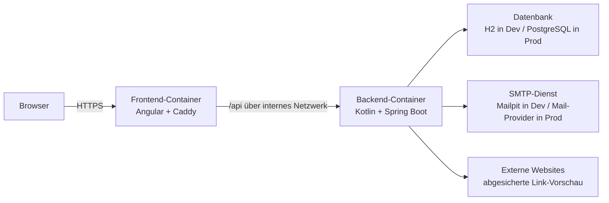

# Stoasis

Stoasis ist eine visuelle Web-App zum Sammeln und gemeinsamen Organisieren von Links, Notizen und Bildern.

## Architektur

Stoasis ist als Monorepo mit zwei unabhängig gebauten Anwendungen organisiert. Das Frontend ist der einzige öffentliche Einstiegspunkt. API-Aufrufe bleiben unter derselben Origin und werden intern an das Backend weitergeleitet.



### Komponenten

- `stoasis-frontend`: Angular-Single-Page-App. Caddy liefert die statischen Dateien aus, übernimmt den SPA-Fallback und leitet `/api` an das Backend weiter.
- `stoasis-backend`: Spring-Boot-API mit Session-Authentifizierung, Domain-Services, Flyway-Migrationen, Uploads und abgesichertem Abruf von Link-Metadaten.
- `compose.yaml`: Lokales Netzwerk für Frontend, Backend und Mailpit. Service-Namen dienen als interne DNS-Namen.
- `.github/workflows`: Zwei unabhängige Image-Builds. Ein Frontend-Diff baut nur das Frontend, ein Backend-Diff nur das Backend; bei Änderungen an beiden laufen beide Builds.

### Request- und Datenfluss

1. Der Browser lädt die Anwendung ausschließlich über den Frontend-Service.
2. Alle Requests an `/api` werden vom Frontend-Proxy intern an das Backend gesendet.
3. Das Backend authentifiziert Benutzer über ein serverseitiges `HttpOnly`-Session-Cookie.
4. Flyway verwaltet dasselbe relationale Schema in beiden Umgebungen.
5. Absolute Upload-, Einladungs- und Magic-Link-URLs werden aus konfigurierten öffentlichen Basis-URLs erzeugt; interne Service-Adressen gelangen nicht zum Browser.

### Umgebungen

| Modus | Frontend | Backend | Infrastruktur |
|---|---|---|---|
| Dev | unoptimiertes Bundle mit Source Maps | Profil `dev`, H2 und lokale Seeds | Mailpit, lokale Ports |
| Prod | optimiertes und gehashtes Bundle | Profil `prod`, PostgreSQL, sichere Cookies | externer SMTP-Dienst, internes Servicenetz |

Beide Images starten ohne Argument im Dev-Modus. Das Argument `prod` aktiviert die Produktionskonfiguration. Die konkreten Befehle stehen in den jeweiligen Projekt-READMEs:

- [Frontend starten und bauen](stoasis-frontend/README.md)
- [Backend starten und bauen](stoasis-backend/README.md)
- [Container- und Deployment-Konfiguration](DEPLOYMENT.md)

## Lokal mit allen Services starten

```bash
docker compose up --build
```

- Anwendung: `http://localhost:8080`
- Backend direkt: `http://localhost:4000`
- Mailpit: `http://localhost:8025`

## Weitere Architekturartefakte

- [Komponentendiagramm](stoa_uml_component_diagram.svg)
- [UI-Wireframe](stoa-wireframe.html)
- [Relationales Datenmodell](stoa_erd_relational.html)
- [Dokumentenmodell](stoa_document_model.html)
