# stoasis
A tool / webapp to save links, pictures and personal notices like a clipboard but with filters, social features and deeper history

# Basic Architectural Vision

# UI Wireframe (claude.ai)
[stoa-wireframe.html](stoa-wireframe.html)

# Datalayer Conceptual
[stoa_erd_relational.html](stoa_erd_relational.html)
[stoa_document_model.html](stoa_document_model.html) 
- on conflict take owners version as truth
- save everything in realtime not after hitting "save" to prevent conflicts
- tags not necessary